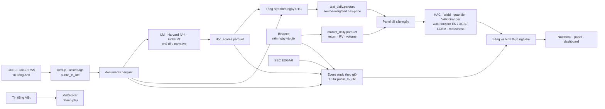

# Crypto Narrative & NLP Sentiment Intelligence

**Blueprint 10 – Công nghệ ứng dụng trong Tài chính (UEL).** Xây chỉ số cảm xúc, sự chú ý và câu chuyện thị trường từ tin tức tiền mã hóa, rồi kiểm định thông tin gia tăng cho lợi suất, biến động và khối lượng của BTC, ETH, SOL, BNB và XRP. Thiết kế đầy đủ: [`docs/blueprint.md`](docs/blueprint.md).

> Nghiên cứu học thuật, không phải khuyến nghị đầu tư.

[Dashboard và bài nghiên cứu trực tuyến](https://crypto-narrative-report.vercel.app) · [Bản Word](paper/paper.docx) · [Bản PDF](paper/paper.pdf)

## Câu hỏi nghiên cứu
| | Câu hỏi | Kiểm định |
|---|---|---|
| RQ1 | Transformer (FinBERT) có tốt hơn từ điển (LM, Harvard IV-4)? | validation gán tay + hồi quy so sánh |
| RQ2 | Tin xấu khác tin tốt ra sao? | Wald β⁻ = β⁺, hồi quy phân vị, sự kiện theo giờ |
| RQ3 | Câu chuyện nào liên hệ mạnh nhất với lợi suất/RV/khối lượng? | Chú ý theo câu chuyện trong hồi quy HAC và sự kiện theo giờ |
| RQ4 | Văn bản dẫn giá hay phản ứng theo giá? | VAR/Granger hai chiều và phản ứng trước giờ công bố |
| RQ5 | Văn bản cải thiện dự báo ngoài mẫu? | Market-only so với market+text; DM-HLN, Clark–West, GW, MCS |

## Dữ liệu và kết quả hiện tại

Kho GKG đã thu đủ 1.369/1.369 ngày trong giai đoạn 2023-01-01 đến 2026-09-30; corpus có tin trên 1.352 ngày (98,76%). Bộ kiểm định phép đo có 300 tiêu đề được nhóm tác giả gán nhãn độc lập. Hai biến thể độ vững theo trọng số nguồn và loại tin giá–đầu cơ đã chạy trên dữ liệu thật. Xem [độ phủ và diễn giải từng bảng](outputs/tables/real/README.md), [kết quả RQ1–RQ5](outputs/tables/real/RESULTS.md) và [trạng thái lần chạy](outputs/tables/real/RUN_DONE.json). Các bảng `outputs/tables/synthetic/` chỉ dùng để thử pipeline, không dùng làm bằng chứng cho bài nghiên cứu.

Trong mẫu hiện tại, chưa có bằng chứng sau hiệu chỉnh kiểm định bội rằng cảm xúc cải thiện dự báo ngoài mẫu; quanh giờ xuất hiện tin, khối lượng giao dịch bất thường tăng nhưng CAR có hướng không đứng vững. Đây là các liên hệ thống kê, không phải tác động nhân quả.

## Nguyên tắc dữ liệu (rút từ góp ý Đề án 05)
- Nhánh chính: **tin tiếng Anh gốc + thư viện chuẩn quốc tế**; không dịch Việt→Anh để chấm.
- Nhánh phụ tiếng Việt: chấm bằng **từ điển tài chính tiếng Việt** (`dict/fin_vn.csv`, `dict/crypto_vn.csv`).
- Gán ngày theo **thời điểm ra công chúng** `public_ts_utc`; báo cáo độ chính xác timestamp.
- Nguồn có sẵn text (GDELT, RSS, SEC EDGAR) thì lấy text, không OCR.
Chi tiết: [`docs/PORTED.md`](docs/PORTED.md).

## Kiến trúc

Tin tiếng Anh tạo chỉ số ngày; SEC EDGAR chỉ phục vụ nghiên cứu sự kiện theo giờ, còn tin tiếng Việt được chấm ở nhánh phụ. Mọi phép gán ngày và mốc sự kiện dựa trên `public_ts_utc` (UTC).



## Chạy

Python ≥ 3.10. Trên Windows PowerShell, dùng môi trường ảo chung theo [`AGENTS.md`](AGENTS.md):

```powershell
py -m venv "$HOME\.venv" # chỉ cần tạo lần đầu
& "$HOME\.venv\Scripts\Activate.ps1"
python -m pip install -r requirements.txt
python -m pytest -q
```

Trên macOS/Linux, thay hai dòng môi trường ảo bằng `python3 -m venv ~/.venv` (lần đầu) và `source ~/.venv/bin/activate`. Chạy lệnh từ gốc repo; `pytest.ini` đã cấu hình đường dẫn import. Tải **Loughran–McDonald Master Dictionary** từ [nguồn chính thức](https://sraf.nd.edu/loughranmcdonald-master-dictionary/) vào `dict/`. API key đặt trong `.env` hoặc `config/config.local.yaml` (không commit); email tác giả điền trong [`paper/paper.md`](paper/paper.md).

## Cách chạy lại toàn bộ

Các parquet đầu vào và nến giờ Binance phải có sẵn cục bộ; dữ liệu thô và parquet lớn không được lưu trong Git. Cài thêm `notebooks/requirements.txt`, rồi chạy mọi cell của [`notebooks/main.ipynb`](notebooks/main.ipynb) từ gốc repo. Notebook chạy offline, tạo bảng trong `outputs/tables/real/`, hình trong `outputs/figures/real/` và diễn giải trong `outputs/tables/real/RESULTS.md`.

CLI cho dữ liệu thật và hai phép kiểm tra độ vững:

```bash
python -m src.models.run_real --source-weighted-text data/processed/text_daily_source_weighted.parquet --exclude-price-text data/processed/text_daily_ex_price.parquet
```

Để tự chạy lại sau khi rebuild xong, dùng `python -m src.models.run_real --watch` (mặc định kiểm tra mỗi 120 giây). Watcher chỉ nhận `data/processed/REBUILD_DONE.json` khi hash khớp, hai lần kiểm tra liên tiếp thấy file ổn định và đã thu đủ ngày GKG; kết quả được ghi vào `outputs/tables/real/RUN_DONE.json`.

Tạo lại bản Word/PDF bằng `python paper/build_docx.py` (PDF cần LibreOffice), và HTML của trang Bài báo bằng `python dashboard/paper.py`; build giao diện bằng `npm --prefix dashboard/web run build`. Trang web không hiện dòng tác giả–đơn vị ở đầu bài; bản Word/PDF vẫn giữ thông tin tác giả theo khuôn bài.

## Làm việc với 2 agent
**Bắt đầu: [`docs/prompts/START.md`](docs/prompts/START.md)** (clone → 2 prompt). Claude Code và Codex chạy song song trong cùng folder, nhánh `dev`: [`docs/PLAN.md`](docs/PLAN.md) (phân công), [`docs/DATA_CONTRACT.md`](docs/DATA_CONTRACT.md) (schema), [`docs/prompts/`](docs/prompts) (prompt từng phiên), [`docs/PROGRESS.md`](docs/PROGRESS.md) (nhật ký).

## Cấu trúc
```
config/ dict/ data/{raw,interim,processed}/ src/{data,features,models,evaluation,utils}/
notebooks/ dashboard/ tests/ outputs/{tables,figures}/ paper/ docs/
```
Nguồn code tái dùng và giấy phép: [`CREDITS.md`](CREDITS.md).
