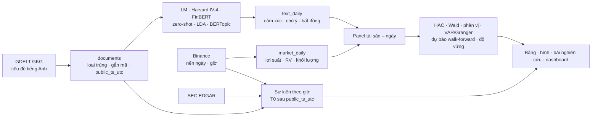

# Narrative và cảm xúc trong tin tức tiền mã hóa

Nghiên cứu đo cảm xúc, sự chú ý và 08 câu chuyện thị trường (narrative) từ tin tức tiếng Anh về tiền mã hóa, rồi kiểm định liệu các tín hiệu văn bản này có mang thông tin gia tăng cho lợi suất, biến động thực hiện và khối lượng giao dịch của BTC, ETH, SOL, BNB và XRP giai đoạn 01/2023 – 09/2026 hay không. Mỗi tin được gán ngày theo thời điểm ra công chúng (`public_ts_utc`), và mọi mô hình văn bản chỉ được ước lượng trên kỳ huấn luyện.

> Nghiên cứu học thuật, không phải khuyến nghị đầu tư.

[](https://github.com/thienanpham160806-code/crypto-narrative-nlp/actions/workflows/ci.yml)
[](https://www.python.org/)
[](dashboard/web/package.json)
[](#dữ-liệu)
[](#phương-pháp)
[](https://crypto-narrative-report.vercel.app)
[](paper/paper.pdf)

**[Dashboard trực tuyến](https://crypto-narrative-report.vercel.app)** · **[Bài nghiên cứu (PDF)](paper/paper.pdf)** · **[Bản Word](paper/paper.docx)**

## Kết quả chính

- **Dữ liệu.** Kho tin GDELT có tin trên 1.352/1.369 ngày (98,76%), gồm 142.646 tin tiếng Anh sau khi loại trùng và 150.160 cặp tin – tài sản cho nghiên cứu sự kiện theo giờ ([coverage.csv](outputs/tables/real/coverage.csv), [RESULTS.md](outputs/tables/real/RESULTS.md)).
- **FinBERT đo sắc thái tốt hơn từ điển (có ý nghĩa).** Trên 300 tiêu đề gán nhãn tay, AUC của FinBERT là 0,894, so với 0,718 của Loughran – McDonald và 0,726 của Harvard IV-4; trên 6.995 nhãn yếu CryptoPanic, AUC lần lượt là 0,712, 0,612 và 0,571 ([sentiment_validation.csv](outputs/tables/sentiment_validation.csv), [sentiment_validation_weak.csv](outputs/tables/sentiment_validation_weak.csv)).
- **Tin không kéo theo lợi suất bất thường có hướng, nhưng kéo theo giao dịch.** CAR trung bình trong 4 giờ sau tin là −0,0068% (p Holm = 1, không có ý nghĩa), trong khi khối lượng giao dịch bất thường trong giờ đầu tăng 0,059 log điểm (p Holm = 0,005) ([event_tests.csv](outputs/tables/real/event_tests.csv)).
- **Giá dẫn trước văn bản.** Kiểm định Granger cho thấy lợi suất dẫn trước cảm xúc FinBERT ở cả 05 tài sản (p Holm < 0,001), còn chiều cảm xúc → lợi suất không có ý nghĩa ở tài sản nào sau hiệu chỉnh Holm ([granger.csv](outputs/tables/real/granger.csv)).
- **Văn bản chưa cải thiện dự báo ngoài mẫu.** Mô hình thêm văn bản có R² ngoài mẫu cao hơn mô hình chỉ có biến thị trường ở 9/30 cặp, nhưng 0/30 cặp có ý nghĩa sau hiệu chỉnh Holm (Diebold – Mariano, Clark – West) ([oos.csv](outputs/tables/real/oos.csv)).

Đây là các quan hệ thống kê trong mẫu, không phải tác động nhân quả.

## Câu hỏi nghiên cứu

| | Câu hỏi | Phương pháp kiểm định | Kết luận |
|---|---|---|---|
| RQ1 | Mô hình transformer (FinBERT) có đo sắc thái tốt hơn từ điển (LM, Harvard IV-4)? | Nhãn tay 300 tiêu đề, nhãn yếu CryptoPanic (AUC, F1); hồi quy dự báo HAC | ✅ FinBERT có AUC cao nhất trên cả hai bộ nhãn; hồi quy chưa đủ để xếp hạng |
| RQ2 | Tin xấu tác động khác tin tốt? | Wald β⁻ = β⁺ trên RV; hồi quy phân vị; chênh lệch phản ứng theo giờ | ⚠️ Wald 0/15 có ý nghĩa sau Holm; theo giờ, tin tốt kéo theo khối lượng lớn hơn tin xấu, ngược kỳ vọng |
| RQ3 | Câu chuyện thị trường nào liên hệ mạnh nhất với lợi suất, RV, khối lượng? | Chú ý theo câu chuyện trong hồi quy HAC; nghiên cứu sự kiện theo câu chuyện | ⚠️ Không có CAR có ý nghĩa; khối lượng bất thường lớn hơn ở tin DeFi, vĩ mô, stablecoin |
| RQ4 | Văn bản dẫn giá hay giá dẫn văn bản? | VAR/Granger hai chiều; phản ứng trước giờ công bố; độ nhạy theo đồng hồ | ✅ Lợi suất dẫn trước cảm xúc ở cả 05 tài sản; chiều ngược lại không có ý nghĩa |
| RQ5 | Văn bản có cải thiện dự báo ngoài mẫu? | Walk-forward EN/XGBoost/LightGBM; R²OS, DM-HLN, Clark – West, Giacomini – White, MCS | ❌ 0/30 cặp có ý nghĩa sau Holm |

## Dữ liệu

| Nguồn | Nội dung | Giai đoạn | Quy mô | Thời điểm công bố |
|---|---|---|---|---|
| [GDELT GKG 2.0](https://www.gdeltproject.org/) | Tiêu đề tin tiếng Anh lọc theo từ khóa tiền mã hóa (lô phút :00 mỗi giờ) | 01/01/2023 – 30/09/2026 | 142.646 tin, có tin trên 1.352/1.369 ngày | Giờ đăng trong trang nếu hợp lệ (cùng ngày, không sau giờ thấy), nếu không thì giờ GDELT thấy tin lần đầu |
| [Binance](https://www.binance.com/) qua `ccxt` | Nến ngày và nến giờ BTC, ETH, SOL, BNB, XRP / USDT | 23/12/2022 – 01/10/2026 | 5 tài sản | Giờ mở nến UTC |
| [SEC EDGAR](https://www.sec.gov/edgar) | Hồ sơ liên quan quỹ ETF tiền mã hóa (chỉ dùng cho nghiên cứu sự kiện) | 2023 – 2026 | 2.053 hồ sơ, 503 ngày | Giờ chấp nhận hồ sơ, đổi từ giờ New York sang UTC |
| [CryptoPanic (Rahsaz)](https://github.com/soheilrahsaz/cryptoNewsDataset) | Phiếu bình chọn của người dùng, dùng làm nhãn yếu | đến 12/2025 | 6.995 tiêu đề | Không dùng làm biến giải thích |
| Nhãn tay | 300 tiêu đề ngẫu nhiên trước kỳ đánh giá ([hướng dẫn](docs/LABELING_GUIDE.md)) | 2023 – 2025 | 300 tiêu đề | — |
| [UCRY](https://sites.google.com/view/cryptocurrency-indices/the-indices/crypto-uncertainty) (Lucey và cộng sự, 2022) | Chỉ số bất định tiền mã hóa theo tuần, biến kiểm soát | đến 29/12/2024 | — | Chuỗi hồi cứu |

Dữ liệu thô và parquet lớn không lưu trong Git; mô tả schema ở [`docs/DATA_CONTRACT.md`](docs/DATA_CONTRACT.md), nguồn chi tiết ở [`docs/SOURCES.md`](docs/SOURCES.md).

## Phương pháp



Nguyên tắc đo lường và kiểm định của đề tài:

- **Thời điểm công bố.** Tin thuộc ngày t khi `public_ts_utc` ∈ [t, t+1) UTC; `public_ts_utc` là giờ đăng hợp lệ hoặc giờ hệ thống thấy tin lần đầu, nên chỉ số ngày t không chứa tin ra sau 00:00 UTC ngày t+1. Độ lệch giữa các đồng hồ được đo và báo cáo.
- **Văn bản gốc, công cụ chuẩn.** Nhánh chính dùng tin tiếng Anh gốc với từ điển Loughran – McDonald, Harvard IV-4 và FinBERT. Nhánh tiếng Việt chấm bằng từ điển tài chính tiếng Việt (`dict/fin_vn.csv`, `dict/crypto_vn.csv`); không dịch giữa hai ngôn ngữ để chấm điểm. Mô hình ngôn ngữ lớn không được dùng làm biến giải thích.
- **Chia mẫu theo thời gian.** Huấn luyện đến 30/06/2025, kiểm tra đến 31/12/2025, đánh giá ngoài mẫu từ 01/01/2026. Bộ vectơ hóa, mô hình chủ đề, ngưỡng phân loại và siêu tham số chỉ được ước lượng trên kỳ huấn luyện và kiểm tra; không có gì được fit trên kỳ đánh giá.
- **Suy luận.** Sai số chuẩn Newey – West; hiệu chỉnh kiểm định bội Holm cho mỗi họ kiểm định; dự báo ngoài mẫu so với mô hình chỉ có biến thị trường bằng Diebold – Mariano (hiệu chỉnh HLN) và Clark – West.

## Cài đặt và tái lập

Phần nghiên cứu (thu dữ liệu, chấm điểm, kiểm định, bài nghiên cứu) chỉ cần **Python ≥ 3.10**. **Node.js ≥ 20.19** (hoặc ≥ 22.12, theo `engines` của Vite) chỉ cần khi build lại dashboard: `npm --prefix dashboard/web ci && npm --prefix dashboard/web run build`. Chạy mọi lệnh từ gốc repo.

**Windows (PowerShell)**
```powershell
py -m venv .venv
.\.venv\Scripts\Activate.ps1
python -m pip install -r requirements.txt
```

**macOS / Linux**
```bash
python3 -m venv .venv
source .venv/bin/activate
python -m pip install -r requirements.txt
```

Bước chuẩn bị:

1. Tải **Loughran – McDonald Master Dictionary** từ [trang chính thức](https://sraf.nd.edu/loughranmcdonald-master-dictionary/) vào `dict/` (giấy phép riêng, không phân phối lại trong repo).
2. Tạo `config/config.local.yaml` (không commit) với `contact_email: <email>` để khai báo User-Agent khi tải dữ liệu; khóa API tùy chọn đặt trong `.env`.

Chạy:

```bash
python -m pytest -q                       # kiểm thử offline, khoảng 1–2 phút
python -m src.models.run_real \
  --source-weighted-text data/processed/text_daily_source_weighted.parquet \
  --exclude-price-text data/processed/text_daily_ex_price.parquet   # phân tích thật, khoảng 25 phút
python paper/build_docx.py                # bài nghiên cứu: .md đã điền, .docx, .pdf (PDF cần LibreOffice)
```

Hoặc chạy toàn bộ [`notebooks/main.ipynb`](notebooks/main.ipynb) sau khi cài `notebooks/requirements.txt`. Dựng lại dữ liệu văn bản từ đầu (`PYTHONPATH=src python -m data.news_gdelt`, rồi `data.build_documents`, `features.narrative`, `features.doc_scores`, `features.daily_index`) mất khoảng 1,5–2 ngày để thu GKG và gần 2 giờ để chấm điểm trên CPU.

## Cấu trúc thư mục

```
config/        cấu hình mẫu, giai đoạn, tài sản, danh sách narrative
dict/          từ điển tài chính tiếng Việt (LM tải riêng)
src/data/      thu thập GDELT, Binance, SEC; dựng documents; bộ canh rebuild
src/features/  từ điển, FinBERT, narrative, chỉ số ngày, kiểm định phép đo
src/models/    hồi quy HAC, Wald, phân vị, VAR/Granger, dự báo walk-forward
src/evaluation/ nghiên cứu sự kiện theo giờ, kiểm định dự báo, báo cáo
notebooks/     notebook chạy offline toàn bộ phân tích
outputs/       bảng và hình (real/ là kết quả nghiên cứu)
paper/         bài nghiên cứu (khuôn .md, Word, PDF) và tài liệu tham khảo
dashboard/     dashboard Vite + React, xuất JSON, công cụ gán nhãn
tests/         kiểm thử offline (fixture và mock, không cần mạng)
docs/          thiết kế, schema dữ liệu, nguồn, quy trình
```

## Đầu ra

- Diễn giải theo RQ: [`outputs/tables/real/RESULTS.md`](outputs/tables/real/RESULTS.md) và [`outputs/tables/real/README.md`](outputs/tables/real/README.md).
- Bảng chính: [hồi quy dự báo](outputs/tables/real/regressions.csv), [Wald](outputs/tables/real/wald.csv), [phân vị](outputs/tables/real/quantiles.csv), [sự kiện theo giờ](outputs/tables/real/event_tests.csv), [bất đối xứng](outputs/tables/real/event_asymmetry.csv), [Granger](outputs/tables/real/granger.csv), [dự báo ngoài mẫu](outputs/tables/real/oos.csv), [Giacomini – White](outputs/tables/real/gw.csv), [độ vững](outputs/tables/real/robustness.csv), [đồng hồ thời gian](outputs/tables/timestamp_accuracy.csv).
- Hình: [CAR theo nhóm cảm xúc](outputs/figures/real/event_car_by_tone.png), [sai số dự báo BTC](outputs/figures/real/oos_loss.png), [hệ số phân vị](outputs/figures/real/quantile_coefficients.png).
- `outputs/tables/synthetic/` chỉ dùng để kiểm thử pipeline, không phải bằng chứng nghiên cứu.

## Hạn chế

- Phân loại dựa trên tiêu đề, không phải toàn văn, vì GKG không cung cấp nội dung bài.
- GDELT chỉ được lấy theo lô phút :00 mỗi giờ (khoảng 25% số bài); nguồn GDELT trống 17 ngày từ 15/06/2025 đến 01/07/2025 nên các ngày này không có tin.
- Giờ GDELT thấy tin trễ trung vị 142 phút so với giờ đăng (42 cặp kiểm chứng) và chỉ một phần rất nhỏ tin có giờ đăng hợp lệ, nên tín hiệu có thể bị chậm so với thời điểm công bố thật.
- Hồi quy dự báo và kiểm định Granger chỉ cho thấy quan hệ dẫn trước, không xác định quan hệ nhân quả.

## Trích dẫn

```bibtex
@misc{pham2026cryptonarrative,
  author       = {Phạm Ngọc Thiên An},
  title        = {Narrative và cảm xúc trong tin tức tiền mã hóa: Bằng chứng từ tín hiệu văn bản theo thời điểm công bố},
  year         = {2026},
  howpublished = {GitHub repository},
  url          = {https://github.com/thienanpham160806-code/crypto-narrative-nlp}
}
```

## Tác giả, giấy phép và quy trình

**Phạm Ngọc Thiên An** · Trường Đại học Kinh tế - Luật, Đại học Quốc gia Thành phố Hồ Chí Minh.

Mã nguồn tái sử dụng và giấy phép bên thứ ba: [`CREDITS.md`](CREDITS.md), [`third_party_licenses/`](third_party_licenses/). Quy trình phát triển: [`docs/WORKFLOW.md`](docs/WORKFLOW.md).
