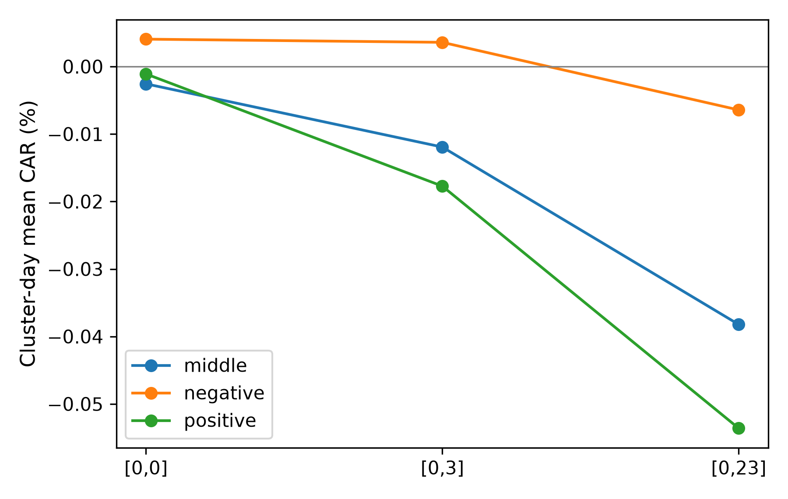
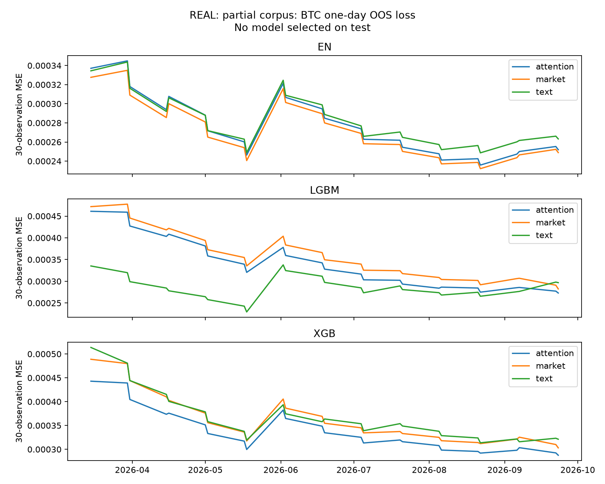

# Narrative và cảm xúc tin tức trên thị trường tiền mã hóa: Bằng chứng theo thời điểm công bố về lợi suất, biến động và hoạt động giao dịch

Crypto news narratives and sentiment: Publication-time evidence on returns, volatility and trading activity

Phạm Ngọc Thiên An

Trường Đại học Kinh tế - Luật, Đại học Quốc gia Thành phố Hồ Chí Minh, Việt Nam

Tác giả liên hệ, Email: ____________________

| THÔNG TIN | |
|---|---|
| DOI | ____________________ |
| Ngày nhận | ____________________ |
| Ngày nhận lại | ____________________ |
| Duyệt đăng | ____________________ |
| Mã phân loại JEL | G12; G14; G41; C53 |
| Từ khóa | tiền mã hóa; cảm xúc tin tức; câu chuyện thị trường; thời điểm công bố; dự báo ngoài mẫu |
| Keywords | cryptocurrency; news sentiment; narratives; publication time; out-of-sample forecasting |

## TÓM TẮT

Nghiên cứu kiểm tra liệu cảm xúc và câu chuyện trong tin tức có bổ sung thông tin cho lợi suất, biến động và khối lượng của 05 tài sản tiền mã hóa ngoài các biến thị trường quá khứ. Dữ liệu gồm tin tiếng Anh và nến Binance giai đoạn 01/2023–09/2026; tin được gán theo thời điểm ra công chúng, còn bước hiệu chỉnh văn bản chỉ dùng kỳ huấn luyện. Phương pháp kết hợp từ điển, FinBERT, hồi quy dự báo, hồi quy phân vị, nghiên cứu sự kiện theo giờ và dự báo ngoài mẫu. Bản dữ liệu thật hiện phủ 339/1.369 ngày; đặc tả Bitcoin có 229 ngày huấn luyện, 47 ngày xác thực và 59 ngày kiểm tra. Chênh lệch phản ứng giá bốn giờ giữa tin xấu và tin tốt không có ý nghĩa sau hiệu chỉnh kiểm định bội, trong khi khối lượng quanh tin tốt lớn hơn. Với 39 cặp tin–tài sản có hai đồng hồ, lựa chọn giờ làm đổi trạng thái ý nghĩa của phản ứng 24 giờ, nhưng chênh lệch ghép cặp chưa có ý nghĩa. Văn bản giảm nhẹ sai số dự báo biến động Bitcoin; đoạn kiểm định liên tục vẫn quá ngắn để kết luận lợi ích gia tăng. Kết quả nhấn mạnh vai trò của đồng hồ công bố và giới hạn suy luận từ dữ liệu tin còn thưa.

## ABSTRACT

This study asks whether news sentiment and narratives add information about returns, realized volatility, and trading volume for five cryptocurrencies beyond lagged market variables. English-language news is matched to Binance candles from January 2023 to September 2026. Each article is assigned a verified public timestamp, and text models are fitted only on the training period. We compare financial dictionaries with FinBERT, estimate predictive and quantile regressions, examine hourly publication events, and evaluate Elastic Net, XGBoost, and LightGBM out of sample. The current real-data snapshot contains news on 339 of 1,369 calendar days; the Bitcoin core specification uses 229 training, 47 validation, and 59 test days. The four-hour price-response difference between negative and positive news is not significant after multiple-testing adjustment, whereas positive news is associated with a larger abnormal volume response. Among 39 article–asset pairs with two timestamps, the choice of clock changes the significance status of the 24-hour response, although the paired difference is not significant. Text slightly lowers Bitcoin volatility forecast error, but the continuous test segment is too short for a reliable incremental-value test. The findings emphasize publication-time discipline and cautious interpretation under sparse news coverage.

## 1. Giới thiệu

Thị trường tiền mã hóa giao dịch liên tục, chịu ảnh hưởng của thông tin công khai và kỳ vọng về công nghệ, quy định cũng như mức độ chấp nhận của tổ chức. Cảm xúc thị trường (market sentiment) biểu thị sắc thái tích cực hoặc tiêu cực trong thông tin; câu chuyện thị trường (narrative) là cách người tham gia gắn các sự kiện riêng lẻ vào một chủ đề có khả năng lan truyền. Shiller (2017) đặt narrative vào cơ chế hình thành kỳ vọng, còn Walker (2024) ghi nhận các chủ đề khác nhau trong báo chí về Bitcoin có quan hệ khác nhau với lợi suất. Khi tin được đăng vào bất kỳ giờ nào, ngày ghi trong kho dữ liệu có thể khác ngày nhà đầu tư thực sự nhìn thấy nội dung. Do đó, xác định đúng thời điểm công bố là điều kiện trước khi diễn giải một tín hiệu văn bản như thông tin dẫn dắt thị trường.

Lợi suất quá khứ, biến động và sự chú ý của nhà đầu tư cũng chứa thông tin dự báo đối với tiền mã hóa (Liu & Tsyvinski, 2021). Các nghiên cứu về Twitter cho thấy ở một số tài sản giá còn dẫn trước hoạt động thảo luận (Kraaijeveld & De Smedt, 2020). Từ góc độ tin tức, Chou và cộng sự (2023) và Kao và cộng sự (2024) nêu bằng chứng định tính trong phần tóm tắt về cơ chế khác nhau giữa tin tiêu cực và tích cực; Gür và Ünal (2026) nêu khả năng sử dụng FinBERT trong dự báo giá Bitcoin. Ba công trình sau chỉ được viện dẫn trong phạm vi thông tin ở tóm tắt, không dùng hệ số chưa đối chiếu từ toàn văn.

Vấn đề liệu tín hiệu văn bản thực sự có giá trị gia tăng vẫn còn bỏ ngỏ khi mô hình đối chứng thiếu biến thị trường mạnh, đồng hồ công bố không được kiểm tra và bộ chấm cảm xúc được đánh giá trên tập tin khác với tập tin dùng dự báo. Đặc biệt, một hệ số có ý nghĩa trong mẫu không đồng nghĩa với lợi ích ngoài mẫu; việc ghép tin được nhìn thấy sau nửa đêm vào ngày hôm trước còn có thể tạo ra sai lệch nhìn trước. Bên cạnh đó, dữ liệu tin thu theo giờ có thể thưa, khiến các kiểm định chuỗi thời gian đòi hỏi đoạn quan sát liên tục trở nên không xác định.

Nghiên cứu này trả lời 05 câu hỏi. RQ1 so sánh FinBERT với từ điển tài chính trong đo cảm xúc tin tiền mã hóa. RQ2 kiểm tra bất đối xứng giữa tin xấu và tin tốt. RQ3 tìm quan hệ giữa sự chú ý tới từng narrative với lợi suất, biến động và khối lượng. RQ4 xem tín hiệu tin dẫn thị trường hay chỉ phản ứng với giá. RQ5 kiểm tra liệu thêm văn bản cải thiện dự báo ngoài mẫu so với mô hình chỉ có biến thị trường. Nghiên cứu đóng góp vào tài liệu học thuật hiện có bằng việc giữ nguyên văn bản tiếng Anh, kiểm tra nhiều đồng hồ thời gian, khóa kỳ kiểm tra khỏi mọi bước chọn mô hình, đối chiếu cả kết quả theo ngày lẫn phản ứng theo giờ và công bố rõ các phép kiểm định chưa đủ điều kiện thực hiện.

Bài nghiên cứu được cấu tạo gồm 05 phần. Sau phần giới thiệu, phần 2 trình bày nền tảng lý thuyết và bằng chứng trước đây; phần 3 mô tả dữ liệu và phương pháp; phần 4 báo cáo các kết quả thật đang có và giới hạn suy luận; phần 5 kết luận và nêu hàm ý.

## 2. Cơ sở lý thuyết và tổng quan các nghiên cứu trước đây

Theo giả thuyết thị trường hiệu quả, giá phản ánh nhanh thông tin công khai, nên tin đã phát hành khó mang lại lợi nhuận dự báo ổn định sau khi tính rủi ro và chi phí (Fama, 1970). Trong khi đó, Baker và Wurgler (2007) lập luận rằng cảm xúc của nhà đầu tư có thể làm giá lệch khỏi giá trị gắn với yếu tố cơ bản. Tetlock (2007) cho thấy sắc thái bi quan trong báo tài chính liên hệ với áp lực giá ngắn hạn; Antweiler và Frank (2004) chỉ ra cả mức bất đồng giữa người viết cũng liên quan đến hoạt động giao dịch. Đối với tiền mã hóa, sự chú ý có thể khuếch đại các tác động này vì nhiều tài sản không tạo dòng tiền cổ tức và nhà đầu tư thường suy luận giá trị từ mức độ chấp nhận trong tương lai.

Lý thuyết kinh tế học narrative của Shiller (2017) gợi ý rằng một thông tin về quỹ ETF, quy định hoặc vụ tấn công có thể đổi kỳ vọng khi được đặt trong một câu chuyện có khả năng lan truyền. Da và cộng sự (2011) cho thấy sự chú ý cũng là biến kinh tế cần tách khỏi sắc thái tin. Bybee và cộng sự (2024) cho thấy tỷ trọng chủ đề trong tin kinh doanh có thể đo sự chú ý ở cấp tổng hợp. Khaksar và cộng sự (2026) đo cảm xúc, bất đồng và mức chú ý theo chủ đề trên diễn đàn Bitcoin; nghiên cứu này dùng tin báo có giờ công bố và đặt các chỉ số ở ngày t trước kết quả ngày t+h. Lucey và cộng sự (2022) xây chỉ số bất định tiền mã hóa từ tin tức, gợi ý cần kiểm soát sự bất định chung khi so sánh sức giải thích của từng narrative. Chuỗi UCRY hồi cứu không có bản công bố theo thời gian thực nên chỉ được dùng như kiểm tra độ vững trong phần dữ liệu có sẵn, không được xem là biến dự báo point-in-time chính.

Giả thuyết phân phối hỗn hợp dự đoán tin, biến động và khối lượng phản ứng cùng thời điểm; giả thuyết thông tin đến tuần tự dự đoán phản ứng lan dần. Chou và cộng sự (2023) cùng Kao và cộng sự (2024) mô tả hai cơ chế này đối với tin Bitcoin trong các tóm tắt công bố. Kraaijeveld và De Smedt (2020) và Kristoufek (2013) nhấn mạnh quan hệ hai chiều giữa sự chú ý và giá. Vì thế, hồi quy một chiều không đủ để khẳng định tin dẫn giá: cần kiểm tra cả phản ứng trước thời điểm công bố và quan hệ dự báo ngược, đồng thời nhớ rằng kiểm định Granger chỉ nói về khả năng dự báo có điều kiện (Granger, 1969).

Việc đo sắc thái phụ thuộc ngữ cảnh ngôn ngữ. Loughran và McDonald (2011) chỉ ra từ điển tổng quát Harvard IV-4 có thể gán sai nghĩa nhiều từ tài chính; FinBERT sử dụng biểu diễn theo ngữ cảnh thay cho việc đếm từ rời rạc (Araci, 2019). Nasekin và Chen (2020) cùng Ider và Lessmann (2022) cho thấy xây tín hiệu tiền mã hóa từ văn bản đòi hỏi xử lý đặc thù miền. Tuy nhiên, độ chính xác phân loại trên nhãn yếu và khả năng dự báo thị trường là hai tiêu chí khác nhau. Vì vậy, RQ1 cần tập nhãn độc lập bên cạnh việc so các hệ số dự báo trên cùng corpus.

Các bằng chứng ngoài mẫu cũng chưa đồng nhất. Garcia và Schweitzer (2015), Ortu và cộng sự (2022) và Critien và cộng sự (2022) kết hợp hoạt động trực tuyến với biến giá trong dự báo hoặc chiến lược giao dịch, nhưng phạm vi nguồn, tài sản và kỳ kiểm tra khác nhau. Auer và Claessens (2018) cho thấy tin quy định cần được tách theo nội dung thay vì gộp toàn bộ thành một nhóm. Nghiên cứu hiện tại đặt câu hỏi gia tăng chặt hơn: liệu mô hình có thêm cảm xúc và narrative vượt mô hình đã chứa lợi suất trễ, biến động, khối lượng, momentum và số tin thô, dưới cùng quy tắc huấn luyện theo thời gian. Việc tách kết quả có ý nghĩa thống kê khỏi giá trị giao dịch sau phí giúp tránh diễn giải một tương quan trong mẫu thành cơ hội đầu tư.

## 3. Phương pháp nghiên cứu

Mẫu thiết kế gồm BTC, ETH, SOL, BNB và XRP trong khoảng ngày 01/01/2023 đến 30/09/2026 theo giờ UTC. Giá đóng cửa và khối lượng USD lấy từ nến ngày và nến giờ Binance; lợi suất là sai phân log giá đóng cửa, còn biến động thực hiện (realized volatility, RV) là tổng bình phương lợi suất log theo giờ (Andersen & Bollerslev, 1998). Tin chính là văn bản tiếng Anh từ GDELT GKG, với hồ sơ SEC dùng riêng cho nghiên cứu sự kiện. Chỉ giữ bản canonical sau khử trùng; tin không gắn mã được gán BTC trong phân tích sự kiện, còn chỉ số ngày theo mã chỉ lấy tin gắn mã tương ứng. Mẫu được chia kỳ huấn luyện đến 30/06/2025, xác thực đến 31/12/2025 và kiểm tra từ 01/01/2026; đầu ra ngày t chỉ dùng tin có `public_ts_utc` trước 00:00 UTC ngày t+1.[^1]

Thời điểm ra công chúng `public_ts_utc` là giờ đăng hợp lệ sớm hơn giờ hệ thống nhìn thấy, hoặc là giờ nhìn thấy nếu không xác minh được giờ đăng. Giờ đăng chỉ hợp lệ khi không muộn hơn giờ nhìn thấy, không sớm hơn quá 48 giờ và cùng ngày UTC; quy tắc cuối tránh đưa bản văn có thể đã sửa ở ngày sau về ngày trước. Kiểm tra 42 cặp GDELT có cả giờ đăng và giờ thấy cho độ trễ tuyệt đối trung vị của `seendate` là 141,5 phút. Vì vậy, việc dùng ngày GDELT thấy như ngày đăng có thể đổi cả cửa sổ sự kiện và ngày của biến giải thích. Nghiên cứu giữ đồng hồ gốc và so hai cách gán giờ trên cùng tập tin có đủ hai mốc.

Với tin d thuộc ngày t và tài sản i, điểm cảm xúc sᵈ được chấm trên văn bản tiếng Anh gốc bằng Loughran–McDonald, Harvard IV-4 và FinBERT; nhánh tiếng Việt dùng từ điển tài chính tiếng Việt cùng từ điển tiền mã hóa riêng, không dịch qua tiếng Anh. Điểm ngày là trung bình đều trên các tin canonical, còn phần âm và dương được tách trước khi lấy trung bình:

$$ Sᵢ,ₜ = (1/Nᵢ,ₜ) Σ(d∈Dᵢ,ₜ) sᵈ ;  NegSᵢ,ₜ = mean[max(−sᵈ,0)] ;  PosSᵢ,ₜ = mean[max(sᵈ,0)]  \tag{1} $$

Sự chú ý tới narrative k được đo bằng tỷ trọng tin nhận nhãn k; bản mềm dùng trung bình xác suất zero-shot. Tám narrative định trước gồm regulation, ETF/institutional, security/hacks, stablecoins, DeFi, AI tokens, macro/monetary và price/speculation. Vectorizer, LDA, BERTopic của Grootendorst (2022) và ngưỡng phân loại chỉ được chọn hoặc ước lượng trên train, với valid dùng để chọn tham số và test giữ nguyên cho đánh giá cuối.[^2]

$$ Aₖ,ᵢ,ₜ = Nₖ,ᵢ,ₜ / Nᵢ,ₜ ;  Aˢᵒᶠᵗₖ,ᵢ,ₜ = (1/Nᵢ,ₜ) Σ(d∈Dᵢ,ₜ) p(k|d)  \tag{2} $$

Nghiên cứu xây dựng phương trình dự báo cho lợi suất, RV và log khối lượng ở kỳ hạn h thuộc {1, 3, 7} ngày như sau. X là tập biến thị trường đã biết tại ngày t gồm lợi suất trễ, RV, log khối lượng và momentum; log(1+N) được đưa vào bậc đối chứng trung gian để tách giá trị của số tin thô khỏi sắc thái tin. Sai số chuẩn hồi quy được hiệu chỉnh tự tương quan và phương sai thay đổi theo Newey và West (1987).

$$ yᵢ,ₜ₊ₕ = αᵢ + β⁻ NegSᵢ,ₜ + β⁺ PosSᵢ,ₜ + Σₖ θₖ Aₖ,ᵢ,ₜ + δ log(1+Nᵢ,ₜ) + γ′Xᵢ,ₜ + εᵢ,ₜ₊ₕ  \tag{3} $$

RQ2 kiểm tra giả thuyết không về tác động bằng nhau của hai phần cảm xúc bằng Wald và đối chiếu hồi quy phân vị ở τ = 0,1; 0,5; 0,9. Cửa sổ phân vị trượt 500 ngày, bước 20 ngày chỉ được diễn giải khi có đủ quan sát hợp lệ; điểm ước lượng ở đuôi không thay thế kiểm định bất đối xứng giữa hai hệ số.

$$ H₀: β⁻ = β⁺ ;  W = (β̂⁻−β̂⁺)² / Var(β̂⁻−β̂⁺)  \tag{4} $$

RQ4 dùng hệ phương trình vectơ tự hồi quy (VAR) hai chiều giữa lợi suất hoặc RV và chỉ số tin, kiểm định Granger sau khi kiểm tra tính dừng bằng ADF/KPSS. Bậc trễ chọn trên kỳ phát triển bằng AIC, nhưng chỉ chạy VAR trên đoạn ngày có tin liên tục đủ dài; ngày trống không được nối giả tạo.[^3]

$$ yₜ = a₀ + Σⱼ aⱼ yₜ₋ⱼ + Σⱼ bⱼ Sₜ₋ⱼ + uₜ ;  Sₜ = c₀ + Σⱼ cⱼ Sₜ₋ⱼ + Σⱼ dⱼ yₜ₋ⱼ + vₜ  \tag{5} $$

Đối với RQ5, Elastic Net, XGBoost và LightGBM được tái ước lượng theo cửa sổ mở rộng. Ba bậc mô hình gồm thị trường, thị trường cộng log(1+N), và thị trường cộng toàn bộ chỉ số văn bản. Kỳ valid chọn siêu tham số; mọi lần tái ước lượng loại quan sát có ngày mục tiêu nằm quá sát ngày dự báo theo quy tắc purge/embargo. Chỉ tiêu chính là RMSE và R² ngoài mẫu theo Campbell và Thompson (2008); chênh lệch lỗi dự báo được đánh giá bằng Diebold–Mariano có hiệu chỉnh mẫu hữu hạn, Clark–West cho mô hình lồng nhau, Giacomini–White và tập mô hình tin cậy khi chuỗi kiểm tra đủ liên tục (Clark & West, 2007; Diebold & Mariano, 1995).[^4]

$$ R²ₒₒₛ = 1 − Σₜ(yₜ−ŷₜ)² / Σₜ(yₜ−ȳₜ,train)² ;  ΔRMSE = RMSEₘₐᵣₖₑₜ − RMSEₘₐᵣₖₑₜ₊ₜₑₓₜ  \tag{6} $$

Nghiên cứu sự kiện dùng T0 là nến một giờ đầu tiên bắt đầu sau `public_ts_utc`, với cửa sổ ước lượng [−168,−25] giờ; BTC dùng lợi suất trung bình, các tài sản khác dùng mô hình thị trường theo lợi suất BTC làm mức kỳ vọng. Từ đó tính lợi suất bất thường tích lũy (CAR), độ lớn lợi suất bất thường và log khối lượng bất thường tại các cửa sổ [0,1], [0,4], [0,24] giờ; cửa sổ [−4,−2] kiểm tra giá trước tin, còn placebo dời mốc 24 giờ. Tin được nhóm theo tercile FinBERT, điểm LM và narrative; kiểm định t, BMP, Wilcoxon gộp theo ngày và hiệu chỉnh Holm hoặc Benjamini–Hochberg (BH). Đây là quan hệ có điều kiện quanh tin, không phải nhận dạng nhân quả vì nhiều sự kiện có thể trùng giờ.

$$ ARᵈ₍τ₎ = rᵢ,ₜ₀₊τ − α̂ᵢ − β̂ᵢ rBTC,ₜ₀₊τ ;  CARᵈ[a,b] = Σ(τ=a…b) ARᵈ₍τ₎  \tag{7} $$

$$ AVᵈ[a,b] = mean₍τ=a…b₎{log(1+Vᵢ,ₜ₀₊τ) − mean[log(1+Vᵢ,est)]}  \tag{8} $$

Các biến được mô tả trong Bảng 1. Bảng 2 thống kê riêng cấp cặp tin–tài sản có nến hợp lệ, vì các phép kiểm định sự kiện sử dụng tập này. Giá trị trung bình cấp sự kiện ở Bảng 2 có trọng số mỗi cặp bằng nhau; phần kết quả kiểm định sau đó gộp theo ngày nên có thể khác. Mọi thống kê trong hai bảng đều lấy từ các tệp `outputs/tables/real/` của bản chụp dữ liệu, không dùng dữ liệu mô phỏng.

Bảng 1

Mô Tả Biến

| Loại biến | Tên biến | Ký hiệu | Đo lường | Nguồn |
|---|---|---|---|---|
| Phụ thuộc | Lợi suất | rᵢ,ₜ | Sai phân log giá đóng cửa ngày | Binance, nến ngày |
| Phụ thuộc | Biến động thực hiện | RVᵢ,ₜ | Tổng bình phương lợi suất log giờ trong ngày | Binance, nến giờ |
| Phụ thuộc | Khối lượng | logVᵢ,ₜ | log(1 + khối lượng USD) | Binance |
| Giải thích | Cảm xúc ngày | Sᵢ,ₜ | Trung bình điểm FinBERT hoặc từ điển của tin canonical | GDELT GKG; mô hình văn bản |
| Giải thích | Tin xấu, tin tốt | NegS; PosS | Trung bình phần âm và phần dương của điểm tin | GDELT GKG; FinBERT |
| Giải thích | Chú ý narrative | Aₖ,ᵢ,ₜ | Số tin narrative k / số tin ngày t; bản mềm dùng xác suất | GDELT GKG; zero-shot |
| Kiểm soát | Số tin thô | log(1+Nᵢ,ₜ) | Log của 1 cộng số tin canonical | GDELT GKG |
| Kiểm soát | Thị trường trễ | Xᵢ,ₜ | Lợi suất trễ, momentum, RV và khối lượng | Binance |
| Kiểm tra độ vững | Bất đồng; UCRY | Dᵢ,ₜ; UCRYₜ | Độ lệch chuẩn cảm xúc; chỉ số bất định tuần đã công bố | GDELT GKG; Lucey và cộng sự (2022) |
| Sự kiện | Lợi suất bất thường | CARᵈ[a,b] | Tổng chênh lợi suất giờ so với mô hình ở [−168,−25] giờ | Binance; giờ tin công bố |

Ghi chú. Biến văn bản ngày t chỉ dùng tin ra công chúng trước 00:00 UTC ngày t+1. Các phép phân tích có UCRY chạy trên mẫu con có dữ liệu; ***, **, * biểu thị mức ý nghĩa thống kê lần lượt là 1%, 5% và 10%. Tính toán của nhóm tác giả.

Bảng 2

Thống Kê Mô Tả Mẫu Sự Kiện Thật

| Biến | Số quan sát | Trung bình | Độ lệch chuẩn | Nhỏ nhất | Lớn nhất |
|---|---:|---:|---:|---:|---:|
| Điểm FinBERT | 36.909 | 0,0451 | 0,5166 | −0,9684 | 0,9445 |
| Điểm LM | 39.003 | −0,1003 | 0,5471 | −1,0000 | 1,0000 |
| CAR [0,4] giờ (%) | 38.951 | −0,0102 | 1,1803 | −11,2381 | 44,1157 |
| Độ lớn lợi suất bất thường [0,4] giờ (%) | 38.951 | 0,0877 | 1,3504 | −7,3263 | 44,3118 |
| Log khối lượng bất thường [0,4] giờ | 38.951 | 0,1106 | 0,6461 | −2,3358 | 4,0676 |

Ghi chú. Mỗi cặp tin–tài sản có trọng số như nhau; khác với trung bình cụm ngày ở phần kết quả. FinBERT không có ở mọi tin SEC. ***, **, * biểu thị mức ý nghĩa thống kê lần lượt là 1%, 5% và 10%. Tính toán của nhóm tác giả.

## 4. Kết quả nghiên cứu và thảo luận

Trước khi diễn giải hệ số, nghiên cứu xem xét phạm vi dữ liệu thật đã có. Bảng 3 trình bày độ phủ văn bản và số ngày dùng được trong đặc tả chính. Đây là mẫu tin đang thu tiếp, không phải toàn bộ tin từng xuất hiện trên thị trường.

Bảng 3

Độ Phủ Tin Và Số Ngày Hợp Lệ Theo Tài Sản

| Tài sản | Ngày lịch | Ngày có tin | Tỷ lệ có tin (%) | Ngày mô hình | Train | Valid | Test |
|---|---:|---:|---:|---:|---:|---:|---:|
| BTC | 1.369 | 339 | 24,76 | 335 | 229 | 47 | 59 |
| ETH | 1.369 | 339 | 24,76 | 317 | 219 | 46 | 52 |
| SOL | 1.369 | 339 | 24,76 | 254 | 183 | 34 | 37 |
| BNB | 1.369 | 339 | 24,76 | 212 | 144 | 31 | 37 |
| XRP | 1.369 | 339 | 24,76 | 286 | 194 | 47 | 45 |

Ghi chú. Độ phủ từ `coverage.csv`, bản chụp 18/10/2026; ngày có tin tính từ 01/01/2023 đến 24/09/2026, mẫu thiết kế kết thúc 30/09/2026. Ngày mô hình còn cần giá và biến trễ hợp lệ. ***, **, * biểu thị mức ý nghĩa thống kê lần lượt là 1%, 5% và 10%. Tính toán của nhóm tác giả.

Điều này có nghĩa là chuỗi giá liên tục không làm cho chuỗi tin liên tục: Bitcoin chỉ có 59 ngày kiểm tra đủ biến, dù khoảng lịch dài hơn. Do đó, kết quả hồi quy và dự báo bên dưới chỉ áp dụng cho ngày được quan sát; không được ngoại suy sang các ngày không thu được tin. Sự thiếu hụt dữ liệu có thể làm yếu kiểm định Granger và làm thay đổi thành phần tin theo thời gian.

Đối với RQ1, Bảng 4 đặt ba điểm cảm xúc vào cùng hồi quy lợi suất Bitcoin ngày kế tiếp. Đây là so sánh khả năng giải thích có điều kiện, chưa phải phép đo độ chính xác gán nhãn của bộ chấm. Bảng kiểm định nhãn độc lập chỉ được bổ sung sau khi bộ nhãn tay được hoàn thành.

Bảng 4

Hệ Số Cảm Xúc Trong Hồi Quy Lợi Suất Bitcoin Ngày Kế Tiếp

| Bộ chấm | Hệ số | Số quan sát | p thô | p Holm |
|---|---:|---:|---:|---:|
| Loughran–McDonald | −0,01380 | 277 | 0,3040 | 1,0000 |
| Harvard IV-4 | −0,00123 | 277 | 0,8853 | 1,0000 |
| FinBERT | 0,01371 | 277 | 0,2542 | 1,0000 |

Ghi chú. Biến phụ thuộc là lợi suất log ngày t+1; mỗi hệ số đến từ đặc tả có cùng biến kiểm soát thị trường và số tin. p Holm hiệu chỉnh trong họ kiểm định xuất ra từ `regressions.csv`. ***, **, * biểu thị mức ý nghĩa thống kê lần lượt là 1%, 5% và 10%. Tính toán của nhóm tác giả.

Không hệ số nào đạt ý nghĩa thống kê sau hiệu chỉnh. Điều này có nghĩa là chưa thể nói FinBERT đo cảm xúc tốt hơn từ điển chỉ dựa vào khả năng dự báo lợi suất ở mẫu này; một bộ chấm có thể đọc đúng sắc thái nhưng sắc thái không dự báo giá. Lập luận về sự phù hợp miền của Loughran và McDonald (2011) và ưu thế biểu diễn ngữ cảnh của Araci (2019) vẫn là giả thuyết đo lường cần đánh giá bằng nhãn độc lập. [[CHỜ_DỮ_LIỆU: bảng RQ1_nhãn_độc_lập]]

Để xem tin xấu có mạnh hơn tin tốt hay không, Bảng 5 báo cáo Wald và phản ứng sự kiện theo sắc thái. Bảng đồng thời cho thấy mức độ chắc chắn khác nhau giữa giá và khối lượng.

Bảng 5

Bất Đối Xứng Tin Xấu Và Tin Tốt

| Phép đo | Số quan sát/ngày | Ước lượng | p thô | p Holm |
|---|---:|---:|---:|---:|
| Wald BTC, lợi suất ngày t+1: β⁻ − β⁺ | 276 | −0,00021 | 0,6115 | 1,0000 |
| Phân vị BTC τ = 0,1: β⁻ − β⁺ | 276 | 0,00003 | 0,9176 | 1,0000 |
| Phân vị BTC τ = 0,5: β⁻ − β⁺ | 276 | −0,00040 | 0,2908 | 1,0000 |
| Phân vị BTC τ = 0,9: β⁻ − β⁺ | 276 | −0,00127 | 0,1461 | 1,0000 |
| CAR xấu trừ tốt [0,4] giờ (điểm %) | 382 ngày | 0,00679 | 0,6758 | 1,0000 |
| Log khối lượng bất thường xấu trừ tốt [0,4] giờ | 382 ngày | −0,03007 | 0,00014 | 0,00308*** |

Ghi chú. Hàng sự kiện dùng tercile FinBERT và so ngày có cả tin xấu, tin tốt; p của khối lượng theo Wilcoxon sau Holm là 0,00081. Bảng lấy từ `wald.csv`, `quantiles.csv`, `event_asymmetry.csv`. ***, **, * biểu thị mức ý nghĩa thống kê lần lượt là 1%, 5% và 10%. Tính toán của nhóm tác giả.

Chưa tìm thấy khác biệt giá có ý nghĩa thống kê giữa hai sắc thái, kể cả ở các phân vị lợi suất Bitcoin. Ngược lại, phản ứng khối lượng của tin xấu thấp hơn tin tốt khoảng 0,030 đơn vị log trong bốn giờ, có ý nghĩa sau Holm và cùng chiều theo Wilcoxon. Điều này có nghĩa là mức giao dịch quanh tin tốt cao hơn trong mẫu ngày ghép cặp, chứ không có nghĩa tin tốt gây ra giao dịch: giờ có tin dày và các sự kiện đồng thời có thể cùng tác động. Dấu này khác với trực giác rằng tin xấu luôn gây phản ứng mạnh hơn, và chưa đủ để bác bỏ cơ chế bất đối xứng nêu trong tóm tắt của Chou và cộng sự (2023) hoặc Gür và Ünal (2026), vì các nghiên cứu dùng thị trường và biến mục tiêu khác. Hình 1 cho thấy CAR của ba nhóm sắc thái thay đổi theo cửa sổ, nhưng chưa cung cấp bằng chứng có ý nghĩa về chênh lệch giá.

Hình 1. CAR Cụm Ngày Theo Sắc Thái FinBERT

Ghi chú. Hình từ dữ liệu sự kiện thật; các điểm là trung bình cụm ngày, không biểu thị khoảng tin cậy. Tính toán của nhóm tác giả.

Bảng 6 xem phản ứng theo nhóm narrative. Mỗi ước lượng là CAR cụm theo ngày ở [0,4] giờ, tính trên tin đã thu và có thể có nhiều tin cùng một ngày.

Bảng 6

Lợi Suất Bất Thường Theo Câu Chuyện Thị Trường

| Nhóm tin | Cặp tin–tài sản | Ngày | CAR trung bình (%) | p thô | p Holm |
|---|---:|---:|---:|---:|---:|
| Toàn bộ | 38.951 | 772 | 0,03715 | 0,2141 | 1,0000 |
| Quy định (regulation) | 3.837 | 520 | 0,04515 | 0,2126 | 1,0000 |
| An ninh/vụ tấn công (security/hacks) | 4.348 | 376 | −0,01637 | 0,5987 | 1,0000 |
| ETF/tổ chức (ETF/institutional) | 10.877 | 510 | 0,00693 | 0,8260 | 1,0000 |

Ghi chú. Trung bình cụm ngày và p t từ `event_tests.csv`; cùng tin có thể tham gia nhiều cửa sổ nhưng mỗi hàng là một narrative xác định. ***, **, * biểu thị mức ý nghĩa thống kê lần lượt là 1%, 5% và 10%. Tính toán của nhóm tác giả.

Các dấu phù hợp một số cách diễn giải thông thường, nhưng không nhóm nào có ý nghĩa sau điều chỉnh kiểm định bội. Điều này có nghĩa là chưa thể xếp hạng narrative theo tác động giá; mức 0,045% của nhóm quy định không thể được xem là lợi nhuận có thể khai thác. Kết quả hiện tại chưa xác nhận hay phủ định kết luận của Walker (2024) và Khaksar và cộng sự (2026), vì họ dùng nguồn tin và thước đo narrative khác. Độ vững với attention mềm, loại tin suy đoán giá và trọng số nguồn cũng chưa đủ dữ liệu đồng bộ để kết luận. [[CHỜ_DỮ_LIỆU: bảng robustness_source_weighted_exclude_price]]

RQ4 được kiểm tra qua phản ứng trước tin và qua thay đổi đồng hồ. CAR thuần trước tin [−4,−2] giờ bằng −0,01560% trên 772 ngày, p thô 0,5206 và p Holm 1,0000; chưa tìm thấy dịch chuyển giá trung bình có ý nghĩa. Tuy nhiên, độ lớn lợi suất bất thường và log khối lượng bất thường trước tin lần lượt bằng 0,1190% và 0,1522, với p Holm 0,00682 và dưới 0,00001. Điều này có nghĩa là hoạt động giao dịch có thể tăng trước mốc công bố mà không tạo lợi suất có hướng; sự chồng lấp giữa các tin là một lời giải thích khả dĩ, không thể gọi đó là rò rỉ thông tin. Bảng 7 cho thấy cùng những tin có hai đồng hồ tạo kết quả khác nhau ra sao.

Bảng 7

Độ Nhạy Của CAR Theo Đồng Hồ Công Bố

| Cửa sổ | Cặp/ngày | CAR giờ đăng (%) | CAR giờ thấy (%) | p giờ đăng Holm | p giờ thấy Holm | p chênh ghép cặp Holm |
|---|---:|---:|---:|---:|---:|---:|
| [0,1] giờ | 39/32 | 0,03999 | −0,12510 | 0,7641 | 0,1870 | 0,4466 |
| [0,4] giờ | 39/32 | −0,16080 | −0,19150 | 0,7641 | 0,2236 | 0,8896 |
| [0,24] giờ | 39/32 | −0,46330 | −1,02130** | 0,6869 | 0,0406 | 0,2009 |

Ghi chú. 39 cặp thuộc 37 tin canonical trên 32 ngày; `published_at_utc` và `seendate` được áp dụng cho đúng cùng cặp tin–tài sản, từ `event_timing.csv`. Dấu ** ở CAR giờ thấy biểu thị p Holm của phản ứng so với 0, không phải p của chênh lệch hai đồng hồ. ***, **, * biểu thị mức ý nghĩa thống kê lần lượt là 1%, 5% và 10%. Tính toán của nhóm tác giả.

Ở 24 giờ, kết quả có ý nghĩa khi tính từ giờ thấy tin nhưng không có ý nghĩa khi tính từ giờ đăng. Điều này có nghĩa là kết luận về một phản ứng khác 0 nhạy với lựa chọn mốc thời gian; kiểm định chênh lệch ghép cặp giữa hai cách đo lại có p Holm 0,2009, nên chưa đủ bằng chứng rằng chính sai lệch đồng hồ tạo ra mức chênh khác 0. Kết quả củng cố yêu cầu kiểm tra đồng hồ trước khi đưa ra tuyên bố giá dẫn tin hay tin dẫn giá. Chuỗi ngày có tin liên tục hiện chưa đủ 30 ngày cho VAR/Granger, vì vậy chưa đủ quan sát để kết luận chiều dự báo ở tần suất ngày. [[CHỜ_DỮ_LIỆU: bảng VAR_Granger_liên_tục]]

Cuối cùng, Bảng 8 so cùng thuật toán Elastic Net trên 59 ngày kiểm tra Bitcoin có đủ đặc trưng và mục tiêu RV ngày sau. Đây là so sánh dự báo ghép cặp, nhưng phần kiểm định chỉ có một đoạn ngắn liên tục.

Bảng 8

Dự Báo Biến Động Bitcoin Ngoài Mẫu, Kỳ Hạn Một Ngày

| Mô hình | Ngày test | RMSE | R² OOS Campbell–Thompson | Số ngày liên tục cho kiểm định |
|---|---:|---:|---:|---:|
| Chỉ thị trường | 59 | 0,000578 | 0,1323 | — |
| Thị trường + số tin thô | 59 | 0,000578 | 0,1323 | — |
| Thị trường + văn bản | 59 | 0,000574 | 0,1433 | 4 |

Ghi chú. Số liệu từ `oos.csv`; R² OOS so với trung bình huấn luyện, không phải R² trong mẫu. Kiểm định Diebold–Mariano của bậc văn bản có p Holm 1,0000 nhưng chỉ dùng 04 ngày liên tục, không đủ để diễn giải xác nhận. ***, **, * biểu thị mức ý nghĩa thống kê lần lượt là 1%, 5% và 10%. Tính toán của nhóm tác giả.

Sai số RMSE giảm nhẹ và R² OOS tăng khoảng 0,011 điểm so với mô hình chỉ có thị trường. Điều này có nghĩa là trong 59 ngày quan sát, điểm dự báo văn bản gần RV thật hơn một chút, nhưng lợi ích gia tăng chưa được xác nhận thống kê do chuỗi kiểm định liên tục chỉ dài 04 ngày. Hình 2 trình bày đường lỗi ngoài mẫu trên các ngày có quan sát, cần đọc cùng độ dài đoạn liên tục nêu ở Bảng 8. Kết quả phù hợp với yêu cầu đánh giá ngoài mẫu của Campbell và Thompson (2008), đồng thời không cho phép khẳng định tín hiệu tin có thể sinh lợi sau phí. Bảng chiến lược cũng chưa thể diễn giải ổn định trên những ngày rời rạc; đây chỉ là phép thử giá trị kinh tế, không phải khuyến nghị giao dịch. [[CHỜ_DỮ_LIỆU: bảng RQ5_DM_GW_MCS_đủ_chuỗi]]

Hình 2. Lỗi Dự Báo Ngoài Mẫu Theo Ngày

Ghi chú. Hình từ dự báo thật của mô hình thị trường và mô hình có văn bản; các khoảng trống trên trục thời gian là ngày không có mẫu ghép hợp lệ. Tính toán của nhóm tác giả.

## 5. Kết luận

Nghiên cứu đặt cảm xúc và narrative tin tức vào cùng một khuôn kiểm tra cho 05 tài sản tiền mã hóa, trong đó thời điểm công bố được xử lý như một phần của phép đo chứ không chỉ là thuộc tính dữ liệu. Trên bản chụp thật hiện có, tin phủ 24,76% ngày lịch. Không có bằng chứng giá sau tin xấu mạnh hơn tin tốt trong bốn giờ hoặc một ngày; khối lượng quanh tin tốt cao hơn trong mẫu ngày ghép cặp. Chưa có narrative nào cho CAR có ý nghĩa sau điều chỉnh kiểm định bội. Việc đổi từ giờ đăng sang giờ hệ thống thấy tin làm đổi trạng thái ý nghĩa ở cửa sổ 24 giờ, nhưng mức chênh hai cách đo chưa có ý nghĩa. Dự báo RV Bitcoin khi thêm văn bản có RMSE thấp hơn rất nhẹ, song RQ5 vẫn chưa có đoạn kiểm định liên tục đủ dài. RQ1 còn cần nhãn kiểm định độc lập; RQ4 còn cần chuỗi tin liền mạch cho VAR/Granger.

Đối với nhà đầu tư, kết quả hiện tại không ủng hộ việc biến một hệ số cảm xúc hoặc một CAR theo narrative thành quy tắc giao dịch. Đối với đơn vị cung cấp dữ liệu và người xây sản phẩm phân tích, thông tin giờ đăng, giờ thấy và quy tắc gán ngày cần được lưu và hiển thị cùng chỉ số, vì thay đổi đồng hồ có thể đổi diễn giải thống kê. Đối với cơ quan quản lý, việc công bố chính xác thời điểm phát hành thông tin giúp đánh giá phản ứng thị trường minh bạch hơn; kết quả hiện tại chưa cho phép suy luận một loại tin gây biến động giá.

Hạn chế lớn nhất là lấy mẫu GDELT theo các lô giờ và độ phủ ngày còn thưa; các tin chồng lấp khiến phản ứng sự kiện khó quy về một tin riêng. Tập audit đồng hồ chỉ có 37 tin dùng được trong so sánh giờ, nhánh tiếng Việt và UCRY chỉ phủ một phần mẫu, còn điểm FinBERT có thể chịu sai lệch miền. Nghiên cứu tiếp theo cần hoàn tất thu tin, đánh nhãn độc lập, kiểm tra các đoạn ngày liên tục, tái ước lượng theo nguồn và giai đoạn, rồi mới kết luận đầy đủ RQ1–RQ5. Các kết luận đã nêu là quan hệ thống kê trên tập quan sát hiện có, không phải tác động nhân quả hay hiệu quả giao dịch được bảo đảm.

## Tài liệu tham khảo

Andersen, T. G., & Bollerslev, T. (1998). Answering the skeptics: Yes, standard volatility models do provide accurate forecasts. *International Economic Review, 39*(4), 885–905. https://doi.org/10.2307/2527343

Antweiler, W., & Frank, M. Z. (2004). Is all that talk just noise? The information content of internet stock message boards. *The Journal of Finance, 59*(3), 1259–1294. https://doi.org/10.1111/j.1540-6261.2004.00662.x

Araci, D. (2019). *FinBERT: Financial sentiment analysis with pre-trained language models* (arXiv:1908.10063). arXiv. https://doi.org/10.48550/arXiv.1908.10063

Baker, M., & Wurgler, J. (2007). Investor sentiment in the stock market. *Journal of Economic Perspectives, 21*(2), 129–151. https://doi.org/10.1257/jep.21.2.129

Bybee, L., Kelly, B., Manela, A., & Xiu, D. (2024). Business news and business cycles. *The Journal of Finance, 79*(5), 3105–3147. https://doi.org/10.1111/jofi.13377

Campbell, J. Y., & Thompson, S. B. (2008). Predicting excess stock returns out of sample: Can anything beat the historical average? *The Review of Financial Studies, 21*(4), 1509–1531. https://doi.org/10.1093/rfs/hhm055

Chou, K.-H., Day, M.-Y., & Chiu, C.-L. (2023). Do bitcoin news information flow and return volatility fit the sequential information arrival hypothesis and the mixture of distribution hypothesis? *International Review of Economics & Finance, 88*, 365–385. https://doi.org/10.1016/j.iref.2023.06.021

Clark, T. E., & West, K. D. (2007). Approximately normal tests for equal predictive accuracy in nested models. *Journal of Econometrics, 138*(1), 291–311. https://doi.org/10.1016/j.jeconom.2006.05.023

Critien, J. V., Gatt, A., & Ellul, J. (2022). Bitcoin price change and trend prediction through Twitter sentiment and data volume. *Financial Innovation, 8*(1), Article 45. https://doi.org/10.1186/s40854-022-00352-7

Da, Z., Engelberg, J., & Gao, P. (2011). In search of attention. *The Journal of Finance, 66*(5), 1461–1499. https://doi.org/10.1111/j.1540-6261.2011.01679.x

Diebold, F. X., & Mariano, R. S. (1995). Comparing predictive accuracy. *Journal of Business & Economic Statistics, 13*(3), 253–263. https://doi.org/10.1080/07350015.1995.10524599

Fama, E. F. (1970). Efficient capital markets: A review of theory and empirical work. *The Journal of Finance, 25*(2), 383–417. https://doi.org/10.2307/2325486

Garcia, D., & Schweitzer, F. (2015). Social signals and algorithmic trading of Bitcoin. *Royal Society Open Science, 2*(9), Article 150288. https://doi.org/10.1098/rsos.150288

Granger, C. W. J. (1969). Investigating causal relations by econometric models and cross-spectral methods. *Econometrica, 37*(3), 424–438. https://doi.org/10.2307/1912791

Grootendorst, M. (2022). *BERTopic: Neural topic modeling with a class-based TF-IDF procedure* (arXiv:2203.05794). arXiv. https://doi.org/10.48550/arXiv.2203.05794

Gür, Y. E., & Ünal, E. (2026). The impact of news sentiment on the Bitcoin price via machine learning and deep learning-based NLP models. *Journal of Forecasting, 45*(3), 895–923. https://doi.org/10.1002/for.70068

Ider, D., & Lessmann, S. (2022). *Forecasting cryptocurrency returns from sentiment signals: An analysis of BERT classifiers and weak supervision* (arXiv:2204.05781). arXiv. https://doi.org/10.48550/arXiv.2204.05781

Kao, Y.-S., Day, M.-Y., & Chou, K.-H. (2024). A comparison of bitcoin futures return and return volatility based on news sentiment contemporaneously or lead-lag. *The North American Journal of Economics and Finance, 72*, Article 102159. https://doi.org/10.1016/j.najef.2024.102159

Khaksar, E., Biktimirov, E. N., Ayanso, A., & Sokolyk, T. (2026). Bitcoin returns and volume: Uncovering investor sentiment through topic modeling. *International Review of Financial Analysis, 116*, Article 105197. https://doi.org/10.1016/j.irfa.2026.105197

Kraaijeveld, O., & De Smedt, J. (2020). The predictive power of public Twitter sentiment for forecasting cryptocurrency prices. *Journal of International Financial Markets, Institutions and Money, 65*, Article 101188. https://doi.org/10.1016/j.intfin.2020.101188

Kristoufek, L. (2013). BitCoin meets Google Trends and Wikipedia: Quantifying the relationship between phenomena of the Internet era. *Scientific Reports, 3*, Article 3415. https://doi.org/10.1038/srep03415

Liu, Y., & Tsyvinski, A. (2021). Risks and returns of cryptocurrency. *The Review of Financial Studies, 34*(6), 2689–2727. https://doi.org/10.1093/rfs/hhaa113

Loughran, T., & McDonald, B. (2011). When is a liability not a liability? Textual analysis, dictionaries, and 10-Ks. *The Journal of Finance, 66*(1), 35–65. https://doi.org/10.1111/j.1540-6261.2010.01625.x

Lucey, B. M., Vigne, S. A., Yarovaya, L., & Wang, Y. (2022). The cryptocurrency uncertainty index. *Finance Research Letters, 45*, Article 102147. https://doi.org/10.1016/j.frl.2021.102147

Nasekin, S., & Chen, C. Y.-H. (2020). Deep learning-based cryptocurrency sentiment construction. *Digital Finance, 2*(1–2), 39–67. https://doi.org/10.1007/s42521-020-00018-y

Newey, W. K., & West, K. D. (1987). A simple, positive semi-definite, heteroskedasticity and autocorrelation consistent covariance matrix. *Econometrica, 55*(3), 703–708. https://doi.org/10.2307/1913610

Ortu, M., Uras, N., Conversano, C., Bartolucci, S., & Destefanis, G. (2022). On technical trading and social media indicators for cryptocurrency price classification through deep learning. *Expert Systems with Applications, 198*, Article 116804. https://doi.org/10.1016/j.eswa.2022.116804

Shiller, R. J. (2017). Narrative economics. *American Economic Review, 107*(4), 967–1004. https://doi.org/10.1257/aer.107.4.967

Tetlock, P. C. (2007). Giving content to investor sentiment: The role of media in the stock market. *The Journal of Finance, 62*(3), 1139–1168. https://doi.org/10.1111/j.1540-6261.2007.01232.x

Walker, C. B. (2024). Going mainstream: Cryptocurrency narratives in newspapers. *International Review of Financial Analysis, 94*, Article 103305. https://doi.org/10.1016/j.irfa.2024.103305

[^1]: Khoảng ngày t là [00:00, 24:00) UTC. `public_ts_utc` chỉ nhận giờ đăng nếu không sau giờ thấy, cách không quá 48 giờ và cùng ngày UTC; nếu không, lấy giờ thấy. Quy tắc ngăn gán văn bản quan sát ở ngày sau về ngày trước.

[^2]: Zero-shot dùng embedding của văn bản và mô tả narrative; xác suất mềm chuẩn hóa trên 08 nhóm. LDA và BERTopic chỉ fit trên train; lựa chọn số chủ đề hoặc ngưỡng dùng valid, không nhìn test.

[^3]: ADF có giả thuyết không là chuỗi có nghiệm đơn vị; KPSS có giả thuyết không là chuỗi dừng. Thiếu đoạn ngày liên tục không được bù bằng giá trị 0 vì 0 có nghĩa kinh tế khác với không thu được tin.

[^4]: Purge loại quan sát huấn luyện có ngày mục tiêu chạm ngày dự báo; embargo chừa thêm khoảng h ngày. Diebold–Mariano dùng hiệu chỉnh Harvey–Leybourne–Newbold; Clark–West xét sai số dự báo của mô hình lớn hơn lồng mô hình nhỏ.
